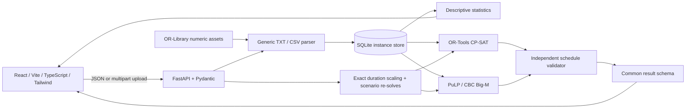

# Sequence · Job-shop scheduling lab

A working FastAPI + React application for parsing job-shop instances, computing statistics, optimizing schedules with CP-SAT or a Big-M MILP, and re-solving user-defined processing-time scenarios.

## Run locally

Requires Python 3.12+ for the locked environment, Node.js 22+, and pnpm 11.19 (`npm install -g pnpm@11.19.0`). The application source targets Python 3.11+, but dependency wheels in this tested lock may require a newer interpreter.

From the repository root, on Windows PowerShell:

```powershell
python -m venv .venv
.\.venv\Scripts\python.exe -m pip install -r backend/requirements-dev.txt
cd frontend
pnpm install --frozen-lockfile
cd ..
.\.venv\Scripts\python.exe scripts/dev.py
```

On macOS/Linux:

```bash
python3 -m venv .venv
.venv/bin/python -m pip install -r backend/requirements-dev.txt
cd frontend
pnpm install --frozen-lockfile
cd ..
.venv/bin/python scripts/dev.py
```

Open [the app](http://127.0.0.1:5173) and [interactive API documentation](http://127.0.0.1:8000/docs). Ctrl+C stops both services. Alternatively, run `python -m uvicorn backend.main:app --reload` from the root and `pnpm dev` from `frontend` in separate terminals. The Vite development proxy forwards `/api` to port 8000.

Select a benchmark or upload a file, choose the objective and engine, and click **Solve schedule**. Inspect the Gantt, operation times, job completions, and machine sequences. **Dataset overview** includes paste-to-load and distribution statistics. **Sensitivity analysis** accepts your own percentage deltas. **Export schedule** downloads the actual result and instance metadata as JSON.

## Docker deployment

```bash
docker compose up --build -d
```

Open [the containerized app](http://127.0.0.1:8080). Nginx serves the production React build and proxies `/api` to FastAPI. SQLite data persists in the `instances` volume. `docker compose down` stops the services without deleting that volume.

The Compose ports bind to localhost. For a remote deployment, put this Compose stack behind your HTTPS reverse proxy and access controls, or deploy the backend Dockerfile on a Python-capable container host and serve `frontend/dist` behind an equivalent `/api` proxy. Preserve a writable volume at `/app/storage`. Proxy timeouts must accommodate baseline plus scenario solve budgets; the included Nginx configuration allows this. No app authentication is included; this is a single-user/project-demo service. CP-SAT/CBC CPU workloads require a Python/container host: the requested solver stack is not compatible with a JavaScript-only Workers deployment. Docker is provided but was not run in the development environment because Docker is unavailable there.

## Architecture



`backend/parser.py` owns parsing; `stats.py` owns descriptive statistics; `solvers.py` contains the two independent models, exact time conversion, and shared validation/output; `sensitivity.py` scales and re-solves; `store.py` persists raw instance text; `main.py` exposes the API. `frontend/src` contains the working interface and data-driven SVG Gantt. Recharts plots sensitivity results. All problem dimensions, durations, assignments, machine workloads, and schedule coordinates derive from the input. UI layout dimensions, time-budget defaults, mathematical constants, and request/numerical safety limits are configuration, not scheduling data.

## Dataset source and formats

Bundled `data/ft06.txt` and `data/ft10.txt` are numeric blocks extracted from J. E. Beasley's public [OR-Library job-shop collection](https://people.brunel.ac.uk/~mastjjb/jeb/orlib/jobshopinfo.html), specifically [jobshop1.txt](https://people.brunel.ac.uk/~mastjjb/jeb/orlib/files/jobshop1.txt). The collection attributes these benchmarks to Fisher and Thompson. Commentary is not bundled. `data/sources.json` records the source and SHA-256 of each normalized numeric block; `python scripts/fetch_benchmarks.py` reproduces the extraction. The app makes no network request to OR-Library at runtime. Additional numeric `.txt` assets placed in `data` appear automatically in the benchmark selector after the next listing.

**OR-Library TXT:** first line is `<num_jobs> <num_machines>`, followed by exactly one line per job, each with `<machine_id> <processing_time>` pairs for exactly `num_machines` operations. Machine IDs are zero-based and must fit the header. Blank lines, UTF-8 BOM, `#` comments, and an original single-instance `instance NAME` wrapper are accepted. A collection containing multiple instances must be split into individual instance blocks. Repeated machine visits are allowed. The UI labels numeric jobs/machines starting at 1; returned numeric indices remain zero-based.

**CSV:** header is `Job,Operation,Machine,ProcessingTime` (case-insensitive, any column order). Spaces, underscores, and hyphens in column names are ignored, so `Processing Time` and `Processing_Time` are also accepted. Job and machine labels are preserved; machines and jobs are indexed by first appearance. Operations may use numeric indices or labels such as `O1`, `Op1`, and `Operation 1`. Their numeric positions must be unique and consecutive within each job, starting at 0 or 1; rows may arrive out of sequence and are sorted numerically (so `O10` follows `O9`, not `O1`). Different labels for the same position, such as `1` and `O1` within a job, are rejected as duplicates. Jobs may have different numbers of operations, and may revisit a machine. Returned operation indices are normalized to zero-based, displayed one-based. Both formats require finite, strictly positive durations; zero-length operations are deliberately rejected to keep disjunctive semantics consistent across engines. Decimals are supported without whole-unit rounding.

## Formulation

For operation `(i,j)`, let `p[i,j]` and its machine be input data and `S[i,j] >= 0` its start. The safe horizon and Big-M are `H = M = sum(p)`. Job precedence is `S[i,j+1] >= S[i,j] + p[i,j]`. Job completion is `C[i] = S[i,last] + p[i,last]`; `C_max >= C[i]` for every job.

For every pair `a,b` using a common machine, the MILP adds binary `x[a,b]` and:

```text
S[a] + p[a] <= S[b] + M * (1 - x[a,b])
S[b] + p[b] <= S[a] + M * x[a,b]
```

The MILP uses bounded integer starts after exact rational scaling. For deterministic job-shop durations this loses no optimum: for any feasible machine order, its earliest schedule consists of sums of durations and lies on this lattice. CP-SAT instead uses start/end/interval variables and `AddNoOverlap` per machine. See Google's [job-shop model documentation](https://developers.google.com/optimization/scheduling/job_shop) and the [PuLP documentation](https://coin-or.github.io/pulp/).

- **Makespan objective:** minimize `C_max`.
- **Idle-time objective:** compute fixed machine workload `W[k] = sum(p on k)`, model `C[k] = max(operation end on k)`, and minimize `sum(C[k] - W[k])`. CP-SAT uses a maximum equality; MILP uses lower bounds plus a final-operation selector for an exact maximum even when makespan is selected. Unused machines have zero completion, workload, and idle time.

Idle time includes the initial wait and internal gaps up to each machine's final completion, **excluding its tail after completion**. Using `num_machines * C_max - sum(p)` would merely restate makespan minimization and is not this objective. Utilization in the UI is separately measured across the common makespan horizon.

Statistics use population standard deviation (`pstdev`). The makespan lower bound is `max(longest job duration, largest machine workload)`. Empty-machine duration statistics are null, with count and workload zero.

Durations are parsed as exact fractions. A common time unit is derived using denominator LCM and numerator GCD, so each duration becomes an exact integer number of solver ticks. Returned times are converted to original units. A warm start is computed generically from ready operations; it contains no benchmark-specific solution. Every returned incumbent is independently checked for complete operation coverage, precedence, nonnegative starts, horizon bounds, and no machine overlap.

## API

| Method | Path | Request / response |
|---|---|---|
| GET | `/api/health` | Service health |
| GET | `/api/benchmarks` | Discovered benchmark names, IDs and parsed dimensions |
| POST | `/api/instance` | JSON `{ "benchmark": "ft06" }`, JSON `{ "text": "…", "name": "…" }`, or multipart `file`; returns `instance_id` and parsed summary |
| GET | `/api/instance/{id}/stats` | Overall, job and machine statistics, makespan lower bound |
| POST | `/api/instance/{id}/solve` | `{ "objective": "makespan" or "idle_time", "solver": "cp_sat" or "pulp_bigm", "time_limit_s": number }` |
| POST | `/api/instance/{id}/sensitivity` | Same solver settings plus `{ "deltas": number[] }`; baseline plus independently re-solved scenarios |

Both engines return operations with job/operation/machine indices, labels, duration, start and end; job completion times; each machine's ordered sequence, workload, completion and idle time; makespan, total idle time, selected objective value, proof status, search time, best bound and relative gap when available. A result with no incumbent has null metrics and empty schedules. `time_unit` is original time units per solver tick; `big_m` is the data-derived horizon in original units. `wall_time_s` includes model construction and solving; the configured time limit governs solver search, so total request time can be slightly longer.

Statuses are `optimal`, `feasible`, `no_solution`, `infeasible`, and `model_invalid`. CBC's model status alone is insufficient: the implementation also requires its optimal solution status and proof message before marking a result optimal. A time-limited incumbent is feasible, never labeled optimal. CBC runs serially with relative temporary filenames to avoid bundled Windows threading/path issues, and a process guard kills a stalled run after the search budget plus ten seconds; if no solution file was returned, the response contains no schedule. The reported best bound/gap relates to the selected objective, not always makespan.

Sensitivity applies `p' = p * (1 + delta/100)` to every operation using exact arithmetic. The baseline and all distinct requested deltas (including explicitly entered zero) are re-solved. Percent changes are relative to the fresh baseline; they are null when the baseline is zero or either run has no solution. Uniform scaling mathematically scales proven optima; unproven incumbents can vary with search behavior. No predefined scenario array or lookup table exists.

## Validation and limitations

```powershell
.\.venv\Scripts\python.exe -m pytest -q
.\.venv\Scripts\python.exe -m ruff check backend scripts
cd frontend
pnpm run build
```

Tests compare benchmark parsing to raw assets, reject malformed input, verify actual solver schedules, compare both objectives and engines with independent exhaustive machine-order enumeration on a small fixture, test fractional scenarios and real re-solve calls, and exercise uploads/API errors. An FT06 integration regression uses the published optimum only as a documented constant in the test file. There are no expected schedules or benchmark-optimum constants in application code.

CP-SAT is recommended for larger benchmarks. CBC's Big-M formulation has quadratically many machine-pair binaries and may not prove optimality before its time limit. Even FT10 can be difficult; the UI makes no fixed optimality promise. The service permits one optimization request at a time per process; concurrent requests receive a clear 503 while stats/health remain available. Run one Uvicorn worker for this local demo. Multi-user production operation would need authentication, a job queue, quotas, cancellation, and worker isolation.

Files are limited to 2 MB; time limits must be in `(0, 300]` seconds; one sensitivity request accepts up to 20 deltas, each strictly above −100. Numeric parsing allows up to 30 significant digits and decimal exponents of magnitude at most 12; models with excessively large exact integer scales are rejected. These are resource/precision safeguards, not hardcoded problem instances. Large permitted files can still be expensive to model. Optimize trusted, appropriately sized instances. Sensitivity is a synchronous API call and may take up to the sum of its per-run budgets plus model construction. Closing the page does not cancel a server-side solve.

Instances persist under `.local/instances.sqlite3` by default; override with `JSSP_DB_PATH`. Returned results live in frontend memory and can be exported; changing the instance clears previous results. No slides were supplied, so `REPORT.md` maps the requirements in the provided build brief rather than inventing slide numbers.
